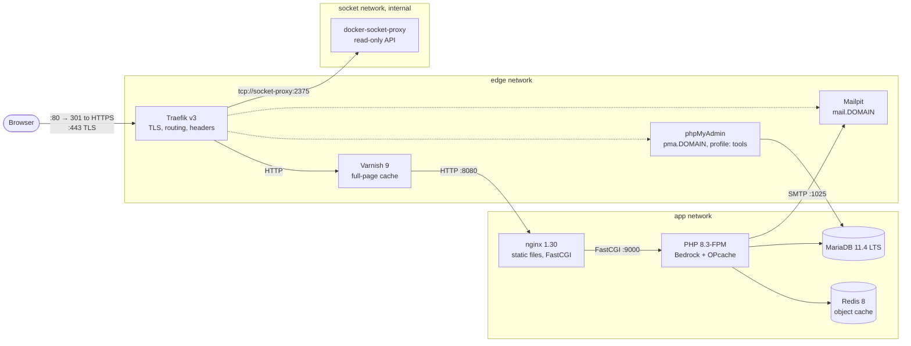

# WordPress on Docker

[](https://github.com/bartlomiejw/docker-wordpress/actions/workflows/ci.yml)
[](LICENSE)

A WordPress stack built with Docker Compose. It is set up the way you would run a busy
WordPress site: TLS at the edge, a full-page cache, an object cache, health-checked
services and one command for each routine job. The same files run on a laptop
(`*.localhost`, local certificates) and on a single production host (Let's Encrypt).

WordPress is managed with [Bedrock](https://roots.io/bedrock/): Composer handles
dependencies, configuration comes from environment variables and the web root is kept
separate from the rest of the project.

## Contents

- [Architecture](#architecture)
- [Features](#features)
- [Requirements](#requirements)
- [Quick start](#quick-start)
- [Local vs production](#local-vs-production)
- [Configuration](#configuration)
- [Make targets](#make-targets)
- [Caching strategy](#caching-strategy)
- [Security notes](#security-notes)
- [Troubleshooting](#troubleshooting)
- [Development workflow](#development-workflow)
- [Project layout](#project-layout)
- [Credits](#credits)

## Architecture



How a request moves through the stack:

1. **Traefik** terminates TLS, redirects HTTP to HTTPS, adds security headers and
   forwards the request to Varnish. Traefik finds services through Docker labels, which
   it reads through a filtered, read-only socket proxy.
2. **Varnish** answers cacheable anonymous requests from memory. Everything else goes
   to nginx: logged-in users, admin pages, carts and checkouts.
3. **nginx** serves static files from `app/web` and sends PHP requests to PHP-FPM. It
   only accepts plain HTTP on the internal network.
4. **PHP-FPM** runs WordPress. Database queries go to **MariaDB**. Repeated lookups
   (options, transients, queries) are kept in **Redis**.

## Features

- **Edge:** Traefik v3 with HTTP to HTTPS redirects, TLS 1.2+ only and security
  headers. Production adds HSTS and Let's Encrypt certificates (TLS-ALPN-01).
- **Full-page cache:** Varnish with WordPress rules for logged-in, admin and
  WooCommerce traffic, internal-only `PURGE`/`BAN`, grace mode and an `X-Cache` header.
  The VCL has its own unit tests written for varnishtest.
- **Object cache:** Redis (LRU, no persistence) with the Redis Object Cache plugin.
  `make init` installs the plugin and `make install` turns it on.
- **PHP 8.3-FPM:** a custom image with OPcache tuned for WordPress, the extensions
  WordPress needs, phpredis and wp-cli. FPM workers run with your host UID, so files in
  bind mounts stay writable.
- **Bedrock via Composer:** there is no copy of WordPress in this repository.
  `make init` creates a fresh Bedrock project in `app/`.
- **Mail:** Mailpit catches every email sent locally. In production you set
  `SMTP_HOST` to a relay.
- **Operations:** healthchecks and `depends_on: service_healthy` on every service,
  restart policies, log rotation, named volumes and pinned image versions.
- **Tooling:** a self-documenting Makefile and CI that runs lint, config validation,
  VCL tests and a full end-to-end smoke test. Dependabot keeps images and actions
  up to date.

## Requirements

- Docker Engine 24+ or Docker Desktop with **Compose v2.24+**
- GNU Make, Bash and OpenSSL
- Optional: [mkcert](https://github.com/FiloSottile/mkcert), so browsers trust the local
  certificate without a warning
- Ports 80 and 443 free on `127.0.0.1`. To use other ports, see
  [Troubleshooting](#troubleshooting).

You don't need to edit `/etc/hosts`. Browsers and curl resolve `*.localhost` to
`127.0.0.1` on their own.

## Quick start

```bash
git clone https://github.com/bartlomiejw/docker-wordpress.git
cd docker-wordpress

make init      # .env with random secrets, TLS certificate, Bedrock in app/
make up        # build and start; returns once every service is healthy
make install   # install WordPress and enable the Redis object cache
```

| URL                                   | What                                    |
|---------------------------------------|-----------------------------------------|
| https://wp.localhost                  | The site                                |
| https://wp.localhost/wp/wp-admin      | WordPress admin (`WP_ADMIN_*` in `.env`) |
| https://mail.wp.localhost             | Mailpit inbox                           |
| https://traefik.wp.localhost/dashboard/ | Traefik dashboard (basic auth, see `.env`) |
| https://pma.wp.localhost              | phpMyAdmin (`make up PROFILES=tools`)   |

To check that everything works end to end, run `make smoke`.

## Local vs production

| | Local (`compose.yaml`) | Production (`compose.yaml` + `compose.prod.yaml`) |
|---|---|---|
| Start | `make up` | `make up MODE=prod` |
| Certificates | `./certs` (mkcert or self-signed) | Let's Encrypt, stored in the `traefik-acme` volume |
| Listens on | `127.0.0.1` only (`BIND_ADDRESS`) | all interfaces, ports 80/443 |
| Traefik dashboard | `traefik.DOMAIN`, basic auth | disabled |
| HSTS | off | `max-age=31536000` |
| Mail | Mailpit | your relay (`SMTP_HOST`/`SMTP_PORT`); Mailpit disabled |
| `WP_ENV` | from `.env` (default `development`) | `production` |
| OPcache revalidation | every request | every 60 s |
| phpMyAdmin (`tools`) | phpMyAdmin login | basic auth + phpMyAdmin login |

Production checklist:

1. Point the DNS records for `DOMAIN` at the server and open ports 80 and 443.
2. `make init MODE=prod`, then edit `.env`: set `DOMAIN`, `ACME_EMAIL` and
   `SMTP_HOST`/`SMTP_PORT`. The overlay forces `WP_ENV=production`.
3. Optional: try the setup against the Let's Encrypt staging CA first with
   `ACME_CA_SERVER=https://acme-staging-v02.api.letsencrypt.org/directory`. Rate limits
   don't matter there. Remove the line to get real certificates.
4. `make up MODE=prod && make install MODE=prod`.

Deploy code changes with `git pull` in `app/`, then
`make composer ARGS="install --no-dev --optimize-autoloader" MODE=prod`, then
`make purge-cache MODE=prod`.

## Configuration

All configuration lives in `.env`, which is gitignored. `.env.example` is the
documented template. `make init` copies it and replaces every `change-me` with a random
value. Bedrock reads the variables straight from the PHP-FPM environment, so `app/`
has no second `.env`.

| Variable | Default | Description |
|---|---|---|
| `COMPOSE_PROJECT_NAME` | `wordpress` | Prefix for containers, networks and images. Traefik only routes containers from this project. |
| `DOMAIN` | `wp.localhost` | Site hostname. Subdomains `traefik.`, `mail.` and `pma.` are derived from it. |
| `BIND_ADDRESS` | `127.0.0.1` | Interface for the local ports. `0.0.0.0` shares the stack on your LAN. |
| `HTTP_PORT` / `HTTPS_PORT` | `80` / `443` | Published local ports. |
| `WP_HOME` | `https://$DOMAIN` | Set it when `HTTPS_PORT` isn't 443, e.g. `https://wp.localhost:8443`. |
| `WP_ENV` | `development` | Bedrock environment (`development`, `staging`, `production`). |
| `WP_TITLE`, `WP_ADMIN_USER`, `WP_ADMIN_PASSWORD`, `WP_ADMIN_EMAIL` | generated | Used by `make install`. |
| `AUTH_KEY` … `NONCE_SALT` | generated | WordPress salts. |
| `DB_NAME`, `DB_USER`, `DB_PASSWORD`, `DB_ROOT_PASSWORD` | generated | MariaDB credentials. |
| `VARNISH_SIZE` | `256M` | Varnish memory storage. |
| `REDIS_MAXMEMORY` | `128mb` | Redis memory cap (keys are evicted with LRU). |
| `SMTP_HOST`, `SMTP_PORT`, `MAIL_FROM` | `mailpit`, `1025`, `wordpress@example.test` | Outgoing mail from PHP (msmtp). |
| `TRAEFIK_LOG_LEVEL` | `INFO` | Traefik log level. |
| `TRAEFIK_BASIC_AUTH_USERS` | generated | htpasswd entry for the dashboard (and phpMyAdmin in production). Keep it in single quotes. |
| `TRAEFIK_DASHBOARD_PASSWORD` | generated | Plain-text copy of the dashboard password, for your reference only. |
| `ACME_EMAIL` | `admin@example.test` | Let's Encrypt account email (production). |
| `ACME_CA_SERVER` | Let's Encrypt production | ACME directory, e.g. the staging CA. |

`HOST_UID`/`HOST_GID` come from `id -u`/`id -g`, which the Makefile runs for you. The
PHP image uses them so containers write files as you.

## Make targets

Run `make help` to see this list in your terminal. Every target accepts `MODE=prod`, and
`PROFILES=tools` enables phpMyAdmin.

| Target | Description |
|---|---|
| `init` | Create `.env` with random secrets, local certificates and the Bedrock project in `app/`. Safe to re-run. |
| `certs` | Regenerate the local certificate (mkcert if installed, otherwise openssl). |
| `install` | Run `wp core install` (if needed), set pretty permalinks and enable the Redis object cache. |
| `up` / `down` | Start (with build, waits for health) / stop the stack. |
| `restart` | Restart all services, or one with `SERVICE=name`. |
| `ps`, `logs` | Show service status / follow logs (`SERVICE=name` optional). |
| `sh` | Open a shell in a container (`SERVICE=php` by default). |
| `destroy` | Stop and **delete volumes** (database). |
| `wp` | wp-cli in a one-off container: `make wp ARGS="plugin list"`. |
| `composer` | Composer in `app/`: `make composer ARGS="require wp-plugin/query-monitor"`. |
| `db-export` / `db-import` | `FILE=…` (`.sql` or `.sql.gz`). |
| `backup` / `restore` | Database + uploads to/from `backups/<timestamp>/` (`BACKUP=…`). |
| `purge-cache` | Ban everything in Varnish and flush Redis. |
| `config` | `docker compose config` for both modes. |
| `lint` | hadolint, ShellCheck and yamllint, run from pinned Docker images. |
| `test-vcl` | Compile the VCL and run the varnishtest cases. |
| `smoke` | End-to-end checks against the running stack (the same checks CI runs). |

## Caching strategy

### Varnish (full page)

The logic lives in [`docker/varnish/wordpress.vcl`](docker/varnish/wordpress.vcl) and is
covered by [`tests/cache.vtc`](docker/varnish/tests/cache.vtc).

- **Cached:** anonymous `GET`/`HEAD` requests. Pages that send no caching headers
  (WordPress usually sends none) stay cached for 10 minutes, and static assets for
  7 days. Grace mode serves stale content for up to 6 hours while Varnish revalidates,
  or while nginx is down.
- **Bypassed:** `/wp-admin`, `wp-login.php`, `wp-cron.php`, `xmlrpc.php`, previews,
  `Authorization` headers, WooCommerce cart, checkout and account pages, and any request
  with a `wordpress_logged_in_*`, `wp-postpass_*`, `comment_author_*` or
  `woocommerce_*` cookie.
- **Normalized:** other cookies (analytics, consent, test cookies) are dropped. Tracking
  parameters (`utm_*`, `gclid`, `fbclid`, …) are removed, and query strings are sorted
  so equivalent URLs share one cache object.
- **Debugging:** every response has an `X-Cache: HIT | MISS | PASS` header.

```bash
curl -skI https://wp.localhost/ | grep -i x-cache
```

### Invalidation

- `make purge-cache` bans everything.
- `PURGE <url>` invalidates one URL. `BAN <regex>`, or `PURGE` with
  `X-Purge-Method: regex`, invalidates every URL that matches. The format works with the
  [Proxy Cache Purge](https://wordpress.org/plugins/varnish-http-purge/) plugin: install
  it with `make composer ARGS="require wp-plugin/varnish-http-purge"` and set its custom
  Varnish IP to `varnish`.
- Purge requests are only accepted from private networks, and never when they arrive
  through Traefik. Traefik doesn't route `PURGE`/`BAN` at all (it returns 404), and the
  VCL rejects any request that carries Traefik's `X-Real-Ip` header.

### Redis (objects)

Redis keeps WordPress's object cache (options, transients, query results) in memory, so
pages Varnish can't cache (admin, logged-in users) still respond quickly. Redis runs as
a pure cache: `maxmemory` with `allkeys-lru` eviction and no persistence. The connection
constants are added to `app/config/application.php` by
[`docker/bedrock/configure.php`](docker/bedrock/configure.php).

### OPcache

192 MB of memory, 20k files and 16 MB for interned strings. Locally, PHP checks for
changed files on every request. In production it checks every 60 seconds.

## Security notes

- **No raw Docker socket in Traefik.** Traefik talks to
  [docker-socket-proxy](https://github.com/Tecnativa/docker-socket-proxy) over an
  internal network with no internet access. The proxy only allows read-only container
  queries (`CONTAINERS=1`; `POST`, `EXEC`, images and volumes are denied) and mounts the
  socket read-only.
- **Dashboard.** Locally the dashboard is behind basic auth and only listens on
  `127.0.0.1`. In production it is turned off.
- **Database.** MariaDB and Redis don't publish any ports. They are only reachable on
  the internal `app` network, and backups go through `docker compose exec`.
- **Scoped routing.** `exposedByDefault=false` plus a constraint on the compose project
  label: Traefik only routes containers from this stack, even if other stacks share the
  Docker host.
- **TLS and headers.** TLS 1.2+ with modern ciphers. `X-Content-Type-Options`,
  `X-Frame-Options: SAMEORIGIN` (so the Customizer still works), `Referrer-Policy` and
  `Permissions-Policy`, plus HSTS in production. The `Server` and `X-Powered-By`
  headers are removed.
- **nginx hardening.** Dotfiles are blocked, PHP can't run from `uploads/`, `xmlrpc.php`
  is denied (remove that block if you need XML-RPC) and httpoxy is mitigated.
- **Secrets.** Secrets only live in `.env` and are generated per checkout. `.env`,
  `certs/`, `acme.json`, `app/` and `backups/` are gitignored.

## Troubleshooting

**Ports 80/443 are already in use** (another local proxy, for example). Set different
ports in `.env` and restart:

```dotenv
HTTP_PORT=8081
HTTPS_PORT=8443
WP_HOME=https://wp.localhost:8443
```

**The browser warns about the certificate.** Install mkcert, then run `make certs` and
`make restart SERVICE=traefik`. Without mkcert the certificate is self-signed, so you
accept the warning (or use `curl -k`).

**`*.localhost` doesn't resolve in some tool.** Some tools use the system resolver,
which may not handle `*.localhost`. Add `127.0.0.1 wp.localhost mail.wp.localhost
traefik.wp.localhost` to `/etc/hosts`, or use `curl --resolve`.

**502/503 right after `make up`.** Varnish probes nginx every 5 seconds and keeps
answering with 503 until a probe succeeds. `make up` already waits for the container
healthchecks, so this should clear within seconds. If it doesn't, check `make ps` and
`make logs SERVICE=varnish`.

**Changes don't show up for anonymous visitors.** You are looking at a cached page. Run
`make purge-cache`, or install the Proxy Cache Purge plugin (see above).

**"Permission denied" writing uploads (Linux).** The PHP image is built with your UID.
If you change users, rebuild with `make up`. `docker compose build` alone doesn't pass
your UID; the Makefile does.

**Site Health reports failed loopback requests or WP-Cron locally.** Inside the
containers `wp.localhost` doesn't point at Traefik. Locally you can ignore this, or run
due events with `make wp ARGS="cron event run --due-now"`.

**Starting over.** `make destroy && rm -rf app .env certs && make init`.

## Development workflow

This repository uses **trunk-based development**:

- `main` is the trunk. It is protected and always deployable.
- Changes go through **short-lived branches** (`feat/…`, `fix/…`, `chore/…`) that are
  merged within a day or two.
- Pull requests are **squash-merged**, which keeps history linear: one commit per change.
- **Required checks** on `main`: *Lint*, *Compose config*, *VCL compile + varnishtest*
  and *Smoke test*. Dependabot PRs go through the same checks.

See [CONTRIBUTING.md](CONTRIBUTING.md) for details.

## Project layout

```
.
├── compose.yaml              # local stack (base)
├── compose.prod.yaml         # production overlay
├── .env.example              # documented configuration template
├── Makefile                  # all day-to-day commands (make help)
├── docker/
│   ├── php/                  # PHP 8.3-FPM image, php.ini, OPcache, FPM pool
│   ├── nginx/default.conf    # internal HTTP server for Bedrock
│   ├── varnish/              # default.vcl (backend), wordpress.vcl (policy), tests/
│   ├── traefik/dynamic/      # TLS options, default cert, shared middlewares
│   └── bedrock/configure.php # adapts a fresh Bedrock project to this stack
├── scripts/                  # init, certs, install, db, backup, smoke test
├── app/                      # Bedrock project (generated, gitignored)
└── .github/                  # CI, Dependabot, PR template
```

## Credits

- [Bedrock](https://github.com/roots/bedrock) by Roots. It is installed with Composer
  and not shipped in this repository.
- The tracking-parameter and cookie clean-up rules in the VCL are adapted from
  [fevangelou's Varnish configuration gist](https://gist.github.com/fevangelou/84d2ce05896cab5f730a).

## License

[MIT](LICENSE) © Bartłomiej Warias
